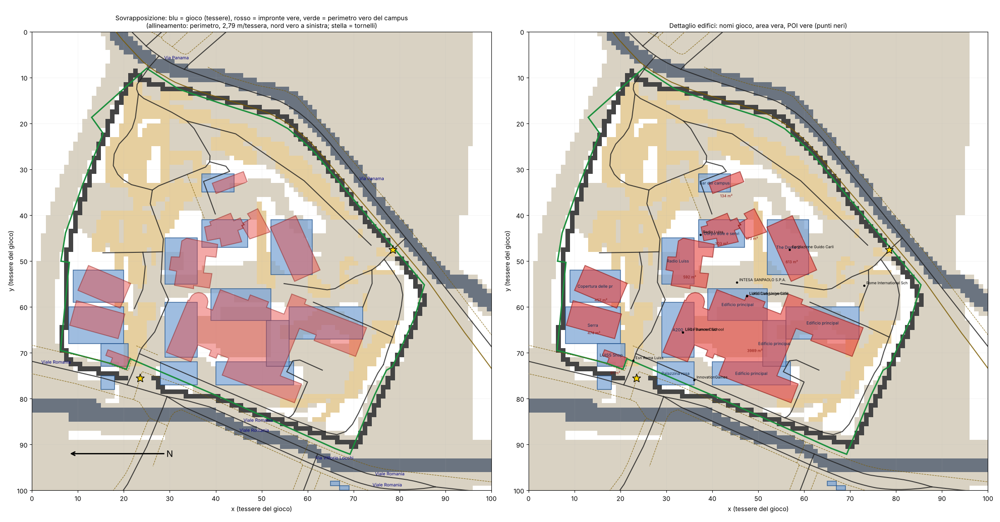

# Campus di Viale Romania 32: confronto tra il gioco e i dati veri

Analisi quantitativa della zona `giardino` (144×144 tessere) contro i dati Overture Maps in `data/mappa/overture/`. Nessun file di `src/` è stato toccato. Grafico: `docs/romania-confronto.png`. Script riproducibili: `scripts/overture/romania-confronto/` (leggono `giardino.json`, estratto dal gioco compilato con `dump.js`).

Blu = gioco (tessere), rosso = impronte vere, verde = perimetro vero del campus, linee nere = strade vere, tratteggio marrone = sentieri veri, stelle = i due tornelli. Il nord vero punta a sinistra.

## 1. Allineamento (scala, orientamento, errore)

I dati nominano pochi edifici: nessun "Aula Chiesa", nessun "The Dome", nessuna villa. Per questo non sono stati usati punti isolati incerti. L'allineamento usa **un solo oggetto certo e nominato**: il poligono `Libera Università Internazionale degli Studi Sociali (LUISS) Guido Carli` (uso del suolo, 32 500 m²), confrontato con il perimetro `romaniaBoundary` del gioco (4 224 tessere). Si cercano scala, rotazione e traslazione che massimizzano la sovrapposizione (nessuna deformazione).

| Parametro | Valore |
|---|---|
| Scala | **2,79 m per tessera** (stima per sola area: 2,77). Non 3 m: scarto del 7 % |
| Orientamento | Il nord vero punta a sinistra nel gioco (di 1,7° verso l'alto). Viale Romania è in basso, Via Panama in alto a destra, Villa Ada a sinistra |
| Sovrapposizione perimetri | IoU **0,947**; area gioco 32 901 m², vera 32 500 m² |
| Distanza tra i due bordi | media 2,5 m (0,9 tessere), mediana 1,8 m, 90° percentile 5,4 m, massimo 9,7 m |

Verifica indipendente: gli edifici interni non sono entrati nell'allineamento. Dopo l'allineamento, 7 edifici del gioco su 8 trovano un'impronta vera a distanza **mediana 3,5 m (1,3 tessere)**, RMS 4,7 m, massimo 7,4 m (escluso l'edificio principale, di forma troppo diversa per un confronto tra centri). L'errore dichiarato dell'allineamento è quindi circa **±5 m (±2 tessere)**. Il perimetro del gioco è corretto; il punto debole sono le forme.

Limiti dell'allineamento: scala e orientamento sono i migliori per il perimetro. Non ho verificato se esiste una deformazione non uniforme (scala diversa sui due assi). L'ancoraggio ai punti "chiesa, Dome, villa, ingresso" non è possibile da dati, perché non sono nominati. I tornelli cadono a posto: Via Panama a 1,2 m dentro il bordo vero, Viale Romania a 8,5 m fuori dal bordo (3 tessere, plausibile per un cancello sul marciapiede).

Una conseguenza pratica: le celle `pq-*` usano 3 m per tessera, il campus 2,79. Su 80 tessere la differenza è circa 17 m sul bordo di raccordo.

## 2. Tabella edificio per edificio

Posizioni in tessere del gioco (x, y, larghezza×altezza) come a runtime. Posizione vera = centro dell'impronta convertito in tessere; dimensione vera = rettangolo minimo ruotato, in metri (tra parentesi in tessere). Sfasamento = distanza tra i centri. "Rapporto" = area gioco / area vera. I rettangoli del gioco sono sempre paralleli agli assi; gli edifici veri sono ruotati di 10-25° rispetto a essi (colonna angolo).

| Edificio (nome nel gioco) | Gioco (tessere) | Vero (impronta Overture) | Sfasamento | Rapporto aree | Angolo | Giudizio |
|---|---|---|---|---|---|---|
| Edificio principale (4 corpi: facciata 40,72 17×5; ala est 56,60 16×7; dorsale 51,63 5×10; chiostro 39,56 13×7) | area 2 593 m², ingombro 92×59 m | `45edbf`, 3 989 m², 108×61 m (38,8×21,9), centro (49,3; 66,6), una L con punta tonda a nord-ovest | 12,2 m (4,4 tessere), IoU 0,43 | 0,65 | 21° | **da ridimensionare e rimodellare** (il vero è il 54 % più grande e di forma diversa: blocco largo a sud-ovest, ala est più bassa) |
| The Dome (nel gioco "The Dome 2", `dome-building` 52,41 9×12) | 841 m², 25×33 m | `3772b6`, 613 m², 36×17 m (13,0×6,1), centro (57,3; 47,3). Il punto "Fondazione Guido Carli" cade dentro | 2,4 m (0,8 tessere), IoU 0,61 | 1,37 | -24° | posizione **ok**, **da ridimensionare** (il vero è allungato 36×17, il gioco 25×33: quasi ruotato di 90° rispetto agli assi) |
| Radio Luiss (`radio-building` 29,45 7×10) | 545 m², 20×28 m | `451b66`, 593 m², 30×27 m (10,6×9,6), centro (35,1; 50,6) | 7,4 m (2,6 tessere), IoU 0,45 | 0,92 | 11° | **ok** come posizione; la pianta vera è più quadrata (10,6×9,6 tessere contro 7×10). **Etichetta da verificare**: il punto vero "Radio Luiss" cade a 1,4 m dall'edificio che il gioco chiama "Corpo aule e servizi" e a 3,7 m da questo |
| Corpo aule e servizi (`services-building` 37,41 10×6) | 467 m², 28×17 m | `4d70f6`, 303 m², 24×18 m (8,6×6,6), centro (42,0; 43,3) | 2,0 m (0,7 tessere), IoU 0,57 | 1,54 | -13° | **ok**; leggermente grande (da 10×6 a circa 9×6) |
| Bar del campus (`bar-building` 37,31 7×4) | 218 m², 20×11 m | `1051c1`, 135 m², 20×7 m (7,2×2,4), centro (43,1; 32,9), h non nota | 7,1 m (2,6 tessere), IoU 0,32 | 1,62 | -21° | **da ridimensionare** (da 7×4 a circa 7×3) e **da spostare** di 2 tessere (verso destra e un po' su) |
| Serra · Padiglione ovest (`polivalente` 8,60 12×8; nome statico: "The Dome 2 · Padiglione ovest") | 748 m², 33×22 m | `06a4b9`, 474 m², 31×16 m (10,9×5,6), altezza 6 m, centro (14,2; 62,8) | 3,5 m (1,2 tessere), IoU 0,57 | 1,58 | 15° | posizione **ok**; **da ridimensionare** (da 12×8 a circa 11×6) |
| Copertura prese d'aria (`sport-court` 9,52 11×7) | 600 m², 31×20 m | `f01029`, 457 m², 28×16 m (10,0×5,9), centro (15,7; 55,6) | 3,5 m (1,3 tessere), IoU 0,62 | 1,31 | 23° | posizione **ok**; **da ridimensionare** (da 11×7 a circa 10×6) |
| LUISS Shop (ex guardiola, `main-gatehouse` 15,68 6×5) | 234 m², 17×14 m | `4d7fc9`, 91 m², 15×7 m (5,2×2,6), altezza 3,8 m, centro (18,9; 71,5) | 3,7 m (1,3 tessere), IoU 0,35 | 2,56 | 20° | posizione **ok**; **da ridimensionare** (da 6×5 a circa 5×3) |
| Edificio vero senza corrispettivo: `13bc9e`, 173 m², 16×13 m (5,8×4,7 tessere), centro (48,6; 42,2) | nessun edificio (solo il creator `giardino-trend` a 50,42 e una aiuola) | si trova subito a ovest di The Dome | | | 31° | **mancante** (piccolo, di servizio) |
| A200 · Aula Chiesa (`chiesa-building` 29,59 7×12) | 7×12 tessere | Nessuna impronta separata nei dati: il 64 % del rettangolo cade dentro l'impronta del principale, vicino alla punta tonda a nord-ovest (circa 34,58) | | | | **non verificabile** da dati (vedi sezione 4) |
| Palazzina rosa (`viale-romania-256` 28,72 8×5) | 8×5 tessere | Nessuna impronta: cade sul marciapiede/strada di Viale Romania, a 9,2 m dal principale | | | | **non verificabile / senza riscontro** |
| Guardiola (`viale-romania-255` 15,75 3×3) | 3×3 | Nessuna impronta nel punto; la piccola impronta `4d7fc9` (vedi LUISS Shop) è a 3 tessere | | | | **non verificabile** |

Contorno, strade e sentieri:

| Elemento | Risultato | Giudizio |
|---|---|---|
| Perimetro | IoU 0,947, errore medio 2,5 m | ok |
| Via Panama | La strada vera dista in media 2,8 m (mediana 1,4 m) dall'asfalto del gioco, 90° percentile 9,7 m | ok |
| Viale Romania | Il gioco ha una fascia orizzontale a y 80-84; la strada vera è inclinata (da circa (0,72) a (70,92)). Scarto medio 6,8 m (2,4 tessere), mediana 4,5 m, 90° percentile 15,5 m, fino a 6 tessere a destra | **da spostare** (soprattutto la parte verso est) |
| Percorsi interni (service e footway non marciapiede) | Il 52 % dei punti veri sta entro 2,8 m da un sentiero o strada del gioco, il 69 % entro 5,6 m. Il "paving" non è discriminante: copre 2 203 delle 4 173 tessere dell'area | **da rivedere** (indicativo: dipende da come si contano le tessere larghe) |

## 3. Proposta di correzione a basso rischio (non applicata)

Ordine di priorità, dal più sicuro. I test sono quelli della scheda: `audit.js`, `reach2.js`, `boars2.js`, `pola2.js`, `flow.js`, `cards.js`, `node scripts/test-sfx.cjs`, `node scripts/smoke.mjs`, più `node scripts/build.mjs`.

| # | Modifica | File/modulo | Rischio | Test da rilanciare |
|---|---|---|---|---|
| 1 | Nomi: nel gioco `dome-building` è "The Dome 2" (`campus-life.js`, riga 401) e nella zona statica era "The Dome 1". Se il proprietario conferma, chiamare l'edificio "The Dome" e togliere "Dome 2" da insegne e testi (`insegne.js`, `lore.js`, `dialogue.js` riga 709, `segreti.js`, `game.js` calcetto). Solo stringhe | `campus-life.js`, `insegne.js`, `lore.js`, `dialogue.js`, `game.js` | Basso, ma `pola`, A200, The Dome e `Matteo · The Dome 2` nelle sfide e nei segreti usano questi testi (chiavi di confronto) | `audit.js`, `cards.js`, `flow.js`, `smoke.mjs` |
| 2 | Ridurre il LUISS Shop da 6×5 a 5×3 (stesso angolo in alto a sinistra) tenendo la porta `viale-luiss-shop` (21,71) | `campus-life.js` (`update("main-gatehouse",...)`) | Basso-medio: tornello (23,75), guardia (18,76), `romania-shop-approach` | `audit.js`, `reach2.js`, `smoke.mjs` |
| 3 | Ridimensionare bar (7×4 → 7×3), serra/polivalente (12×8 → 11×6), prese d'aria (11×7 → 10×6) in `campus.json` o in `refineRomania` | `src/campus.json`, `world.js` (`refineRomania`) | Medio: porte `giardino-caffe` (42,35), `polivalente-door` (27,51), `dome2-door` (20,64), cartello `dome2-vent-sign`; ping pong e biliardino accanto al bar | `audit.js`, `reach2.js`, `cards.js` |
| 4 | Spostare di circa 2 tessere il bar verso (43,33) e le altre impronte indicate | stesso | Medio | `audit.js`, `reach2.js` |
| 5 | Aggiungere un piccolo tetto solido (edificio `13bc9e`, circa 6×5) a ovest di The Dome (circa 46-51, 40-44) | `traceRomaniaCampus` o `refineRomania` | Medio: il creator `giardino-trend` è a (50,42); controllare raggiungibilità | `audit.js`, `reach2.js` |
| 6 | Rimodellare The Dome (da 9×12 a circa 7×12, perché oggi è il 37 % più grande) | `campus.json` (`dome-building`) | **Alto**: `romania-dome` (60,55), `giardino-dome` (60,54), `tutor-entry` (59,58), `segreti-ritorno` (58,59), piazzetta (55,54), storia | tutta la batteria, più passaggio manuale nella storia |
| 7 | Correggere Viale Romania (fascia a y 80-84 → traccia inclinata) e raccordare con le celle `pq-*` | `arrangeRomaniaSurfaces`, `widenCampusWalks`, `quartiere.js` | **Alto**: fermata 360 (14,85), auto parcheggiate, NPC, `giardino-terra` (48,79), ingresso a `pq-1-1-ingresso-luiss` | tutta la batteria |
| 8 | Rimodellare l'edificio principale (da 2 593 a circa 3 900 m², con punta nord-ovest e ala est più bassa) | `campus.json` (4 corpi) | **Alto**: `giardino-mensa` (48,68), `giardino-terra` (48,79), `romania-a200` (36,64), interni di mensa e atrio, A200 (tornello e storia passano da qui) | tutta la batteria; sconsigliato senza foto del campo |

Raccomandazione: fare 1-2 subito, 3-5 insieme dopo le foto, lasciare 6-8 a una fase dedicata con prova a mano delle porte. Una soluzione intermedia per gli edifici obliqui: i rettangoli del gioco non si ruotano, quindi la fedeltà massima è l'approssimazione a gradini, con difetti di IoU 0,5-0,6.

## 4. Quello che i dati non dicono (da raccogliere sul campo)

Da dati non si può verificare:
- **Sensi unici, direzioni, strisce e sensi di marcia** (Overture non li riporta in modo affidabile).
- **Cancelli, tornelli, guardiole, orari di apertura** e chi può entrare da Via Panama. Il perimetro è vero, ma gli accessi pedonali no.
- **Civici reali** degli ingressi: i punti hanno tutti "Viale Romania, 32" con precisione di una decina di metri.
- **Quale edificio è A200 / Aula Chiesa, quale è la Serra/Dome 2, dove sta la villa.** L'impronta del principale ha una punta tonda a nord-ovest che potrebbe essere l'abside, ma non è confermato.
- **Porte, atri, corti interne, scale, altezze** (le altezze sono quasi tutte mancanti).
- **Alberi, panchine, pensiline, recinzioni** (nei dati ci sono solo gli alberi di grande scala, non quelli del campus).

Come raccogliere le foto (indicazione per il proprietario):
1. Una foto frontale per ogni edificio, e una per ogni angolo, con la targa o l'insegna visibile.
2. Una foto di ogni ingresso (Viale Romania, Via Panama, eventuali altri) con il cancello e il civico visibili.
3. Una foto per ogni cartello stradale con il senso unico, fatta a una distanza di circa 5 metri.
4. Per ogni foto annotare: ora, nome dell'edificio, direzione in cui si guarda (nord, sud, ...). Con il telefono basta tenere attivata la posizione, così la foto porta le coordinate.
5. Se possibile, un giro a piedi con la mappa di questo documento stampata (`docs/romania-confronto.png`) segnando a penna dove l'edificio vero è diverso da quello blu.

## 5. The Dome 1 / The Dome 2 nei dati

- Nei dati non esiste nessun edificio, luogo o POI con "Dome" nel nome nella zona (le uniche corrispondenze sono "Domenico" in nomi propri e "The Pleasure Dome" in Piazza Santiago del Cile, a circa 1,4 km). Né "The Dome 1" né "The Dome 2" né "Dome" sono presenti.
- Nei dati c'è un'impronta senza nome di 613 m² (`3772b6`, 36×17 m) che, dopo l'allineamento, cade a 2,4 m dal padiglione che il gioco chiama "The Dome 2" (`dome-building`). Il POI "Fondazione Guido Carli" cade dentro quell'impronta. Altre impronte senza nome vicine: `451b66` (593 m²) e `4d70f6` (303 m²). Non c'è nessun'altra impronta di dimensioni simili che si possa leggere come "secondo Dome".
- Nel gioco: in `campus.json` `dome-building` si chiama "The Dome 1" (zona `dome`: "The Dome · Sala studio") e la zona `dome2` si chiama "The Dome 2 · Padiglione ovest" (edificio `polivalente`). A runtime `campus-life.js` rinomina `dome-building` in "The Dome 2" e `polivalente` in "Serra · Padiglione ovest". L'edificio `polivalente` corrisponde a un'impronta vera alta 6 m (`06a4b9`, 474 m²) e `sport-court` a un'altra (`f01029`, 457 m²), entrambe nell'angolo nord-ovest del campus.
- Cosa si può dire dai dati e basta: il posto dove il gioco mette "The Dome" coincide con un edificio vero; il posto dove il gioco mette "Dome 2" / "Serra" coincide con edifici veri, ma i dati non li nominano. L'attribuzione "The Dome = quell'impronta" va confermata sul campo; non ho tratto altre conclusioni.
